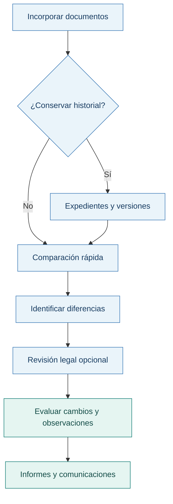
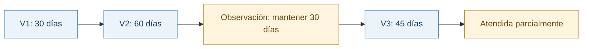

# LexControl

### Comparación documental y gestión de revisiones legales

**Organiza documentos. Identifica cambios. Da seguimiento a observaciones.**

[Descargas](https://github.com/MC-Techcore/LexControl-Releases/releases) · [Manual de usuario](docs/guia-de-usuario.md) · [Notas de versiones](CHANGELOG.md)

---

## ¿Qué es LexControl?

LexControl es una herramienta de trabajo para profesionales que revisan documentos, contratos y sucesivas versiones de un mismo archivo. Integra la comparación textual, la organización por expedientes y el seguimiento de observaciones en una aplicación local.

Su propósito es facilitar la identificación de diferencias y documentar el criterio del usuario, sin sustituir la revisión jurídica.

> [!IMPORTANT]
> RC3 es una versión preliminar. La clasificación de una alerta de Trend Micro sigue pendiente. No ejecutar si el antivirus bloquea el programa. Utilizar exclusivamente documentos ficticios durante la evaluación.

## Cómo funciona

## Explora los módulos

| Módulo | Capacidades |
|---|---|
| [Inicio](docs/guia-de-usuario.md#modulo-2) | Indicadores, actividad reciente y vencimientos. |
| [Comparación rápida](docs/guia-de-usuario.md#modulo-3) | Comparación lado a lado, diferencias e historial. |
| [Expedientes](docs/guia-de-usuario.md#modulo-4) | Organización de documentos, versiones y originales. |
| [Revisiones legales](docs/guia-de-usuario.md#modulo-5) | Evaluación de cambios y seguimiento de observaciones previas. |
| [Observaciones](docs/guia-de-usuario.md#modulo-6) | Comentarios generales, textuales y de área; preparación de correos. |
| [Reportes](docs/guia-de-usuario.md#modulo-7) | Informes Word/PDF y exportación de bitácora a Excel. |
| [Configuración](docs/guia-de-usuario.md#modulo-8) | Perfil, correos, catálogos, notificaciones y diagnóstico. |
| [Ayuda y OCR](docs/guia-de-usuario.md) | Procedimientos, ejemplos y solución de problemas. |

## Ejemplo: revisión de un contrato

El usuario conserva las versiones y evalúa si la corrección responde a su observación. La decisión es manual; finalizar una revisión no implica aprobar el contrato.

## Descarga y primeros pasos

Consulta las [versiones publicadas](https://github.com/MC-Techcore/LexControl-Releases/releases). Una vez autorizada la versión para pruebas:

1. Descarga el ZIP de Windows.
2. Extrae la carpeta completa.
3. Abre LexControl.exe si el antivirus no lo bloquea.
4. Completa la configuración inicial.

La distribución portable incluye sus componentes de ejecución. No requiere instalar Python. La aceptación en equipos externos sigue pendiente.

## Centro de documentación

| Recurso | Contenido |
|---|---|
| [Manual de usuario](docs/guia-de-usuario.md) | Diez guías, diagramas y 39 casos prácticos. |
| [Notas de versiones](CHANGELOG.md) | Cambios técnicos, validaciones y pendientes. |
| [Seguridad y privacidad](SECURITY.md) | Alcance de la evaluación y tratamiento de datos. |

## Privacidad y alcance

El diseño de LexControl es local. Los datos se conservan en la carpeta Datos. RC3 todavía no incorpora cifrado ni bloqueo por contraseña. El OCR y la comparación textual requieren verificación contra los originales y no garantizan detectar todas las diferencias visuales.

---

**LexControl · Portal de distribución y documentación**

Este repositorio no contiene el código fuente de desarrollo.

