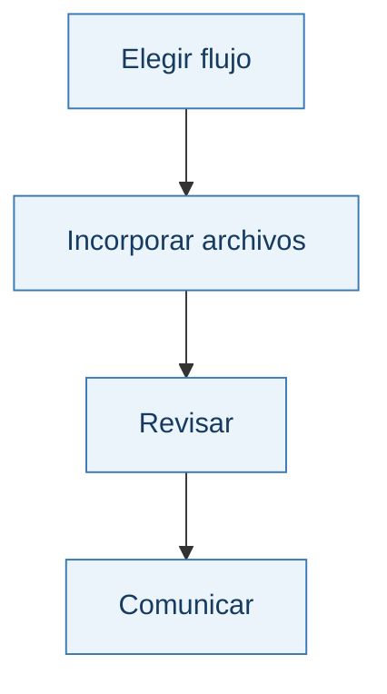
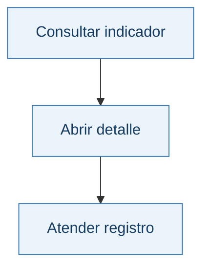
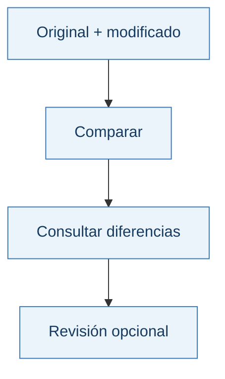
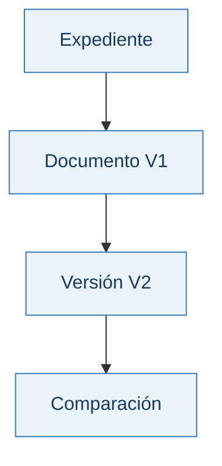
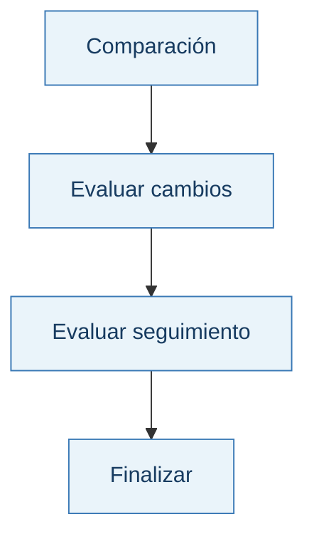
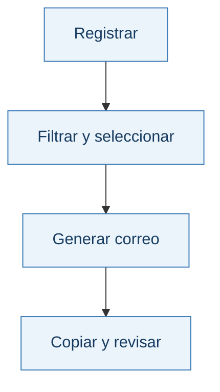
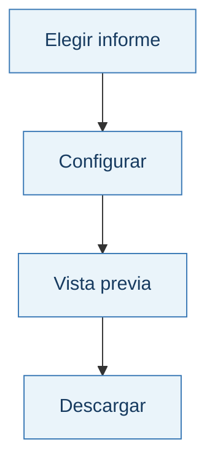
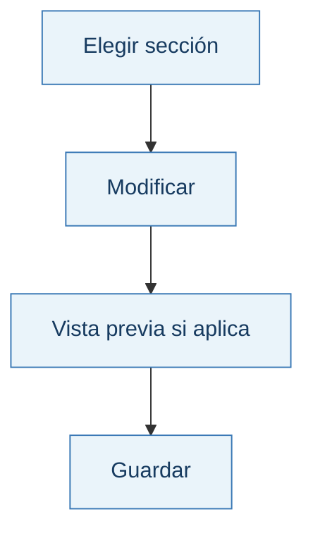
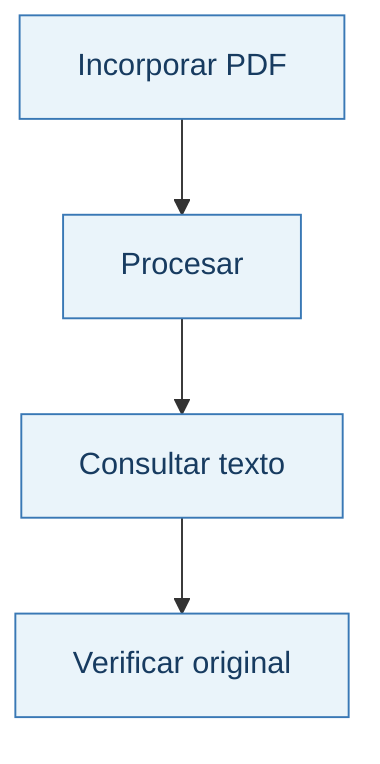
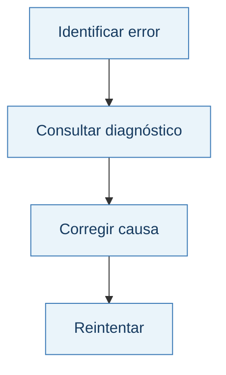

# Manual de usuario | LexControl

**RC3 · Documentación preliminar**

> Utilizar únicamente documentos ficticios. No ejecutar si el antivirus bloquea el programa. La aceptación funcional externa y la evaluación de seguridad están pendientes.

[Volver al inicio](../README.md)

## Preparación del entorno

Una vez autorizada la versión para pruebas, descarga el ZIP publicado, extrae todos sus componentes y abre `LexControl.exe`. El navegador se abre automáticamente. Completa el asistente inicial: perfil profesional, correos, catálogo, notificaciones y diagnóstico. Conserva la carpeta `Datos`.

## Contenido

- [1. Primeros pasos](#modulo-1)
- [2. Inicio](#modulo-2)
- [3. Comparación rápida](#modulo-3)
- [4. Expedientes](#modulo-4)
- [5. Revisiones legales](#modulo-5)
- [6. Observaciones](#modulo-6)
- [7. Reportes](#modulo-7)
- [8. Configuración](#modulo-8)
- [9. OCR y procesamiento](#modulo-9)
- [10. Solución de problemas](#modulo-10)

---

## 1. Primeros pasos

**Elige el flujo adecuado**

No necesitas conocer informática. Un expediente agrupa asuntos; un documento tiene versiones; comparar no significa aprobar.

### Flujo de trabajo

### Procedimiento

1. Comparación rápida para contrastar dos archivos sin crear un expediente.
2. Expedientes para conservar documentos, versiones y seguimiento jurídico.
3. Revisiones legales para evaluar cambios; Observaciones para preparar comunicaciones.

### Casos prácticos

#### Solo quiero saber qué cambió

Recibiste dos borradores y no necesitas organizar un asunto.

1. Abre Comparación rápida
2. Carga el anterior a la izquierda y el nuevo a la derecha
3. Pulsa Comparar documentos y consulta las diferencias

**Resultado esperado:** Puedes consultar cambios sin iniciar una revisión legal.

#### Quiero conservar el historial

Recibirás varias correcciones de un contrato.

1. Abre Expedientes
2. Crea un expediente y agrega el documento inicial
3. Agrega cada archivo posterior como versión del mismo documento

**Resultado esperado:** Los archivos anteriores se conservan.

#### Quiero comunicar comentarios

Ya identificaste cláusulas que requieren corrección.

1. Registra observaciones en el documento o revisión
2. Abre Observaciones y selecciona las pertinentes
3. Pulsa Generar correo, revisa y copia

**Resultado esperado:** El correo queda listo para pegar; no se envía automáticamente.

> **Consideración:** No confundas expediente con archivo: un expediente puede contener varios documentos.

**Pregunta frecuente:** ¿Se envían correos automáticamente? No. LexControl prepara el contenido para copiarlo.

[Volver al contenido](#contenido)

---

## 2. Inicio

**Dashboard y navegación**

Usa Inicio para decidir qué atender primero. Los números representan registros, no una calificación jurídica.

### Flujo de trabajo

### Procedimiento

1. Consulta los indicadores de expedientes, revisiones, observaciones y vencimientos.
2. Selecciona una barra, segmento o indicador con registros para abrir el detalle filtrado.
3. Utiliza las acciones rápidas y consulta la actividad reciente.

### Casos prácticos

#### Retomar una revisión

Dejaste cambios sin evaluar ayer.

1. Abre Inicio
2. Busca Avance de revisiones
3. Selecciona la barra del documento

**Resultado esperado:** Se abre la revisión correspondiente.

#### Atender observaciones

Quieres conocer los comentarios aún abiertos.

1. Selecciona Observaciones abiertas
2. Comprueba el filtro aplicado
3. Pulsa Ver en una observación

**Resultado esperado:** Consulta su comentario y referencia.

#### Consultar vencimientos

Un asunto tiene una fecha límite.

1. Consulta Agenda de vencimientos
2. Selecciona el expediente mostrado
3. Revisa su fecha y estado

**Resultado esperado:** Se muestra el expediente correspondiente.

#### Consultar actividad mensual

Quieres revisar las comparaciones de un mes.

1. Busca Actividad de los últimos seis meses
2. Selecciona una barra con registros
3. Consulta el historial filtrado

**Resultado esperado:** Se muestran los registros del periodo según las fechas disponibles.

> **Consideración:** Una categoría sin registros no permite navegar; no significa que exista un error.

**Pregunta frecuente:** ¿Por qué una gráfica está vacía? Puede no haber registros en esa categoría o periodo.

[Volver al contenido](#contenido)

---

## 3. Comparación rápida

**Comparar dos documentos**

Ten disponibles los dos archivos. Identifica cuál es anterior y cuál es posterior antes de cargarlos.

### Flujo de trabajo

### Procedimiento

1. Selecciona el original a la izquierda y el modificado a la derecha.
2. Pulsa Comparar documentos y espera el procesamiento.
3. Consulta las diferencias y el historial. Si necesitas evaluar cambios, inicia una revisión legal.

### Casos prácticos

#### Cambio de plazo

Un contrato cambia de 30 a 60 días.

1. Abre Comparación rápida
2. Carga V1 a la izquierda y V2 a la derecha
3. Pulsa Comparar documentos
4. Localiza la modificación y lee ambos fragmentos

**Resultado esperado:** Identificas el plazo anterior y el nuevo.

#### Cambio de importe

El precio cambia de 10000 a 12000.

1. Compara los archivos de práctica V1 y V2
2. Consulta Modificaciones
3. Verifica los números en los originales

**Resultado esperado:** Puedes decidir si el importe requiere observación.

#### Word contra PDF

Recibiste un PDF de un borrador Word.

1. Carga ambos archivos en el orden correcto
2. Espera el procesamiento y compara
3. Verifica las diferencias contra los originales

**Resultado esperado:** Obtienes una comparación textual; no una garantía de equivalencia visual.

#### Archivos invertidos

Cargaste el nuevo como original.

1. Antes de comparar, intercambia los archivos o vuelve a seleccionarlos
2. Comprueba el orden
3. Ejecuta la comparación

**Resultado esperado:** Las adiciones y eliminaciones se interpretan en el sentido correcto.

> **Consideración:** Si el texto es extraño o incompleto, consulta el original; no interpretes automáticamente un error OCR como cambio contractual.

**Pregunta frecuente:** ¿Una comparación equivale a una aprobación? No. Es una identificación de diferencias.

[Volver al contenido](#contenido)

---

## 4. Expedientes

**Documentos y versiones**

Un expediente es el asunto; cada documento representa una pieza documental y sus versiones conservan las sucesivas entregas.

### Flujo de trabajo

### Procedimiento

1. Crea un expediente con nombre y tipo.
2. Selecciona Nuevo documento e incorpora su primer archivo.
3. Agrega versiones desde el documento; verifica cuál está vigente.
4. Abre una versión para consultar el original o registrar observaciones. Compara versiones disponibles cuando corresponda.

### Casos prácticos

#### Crear un expediente

Comienzas una contratación.

1. Abre Expedientes
2. Captura nombre y tipo
3. Crea el expediente
4. Pulsa Nuevo documento y selecciona el primer archivo

**Resultado esperado:** Se registra el documento con su primera versión.

#### Agregar varios documentos

El asunto tiene contrato y anexo independientes.

1. Abre el mismo expediente
2. Usa Nuevo documento para el contrato
3. Repite para el anexo

**Resultado esperado:** Cada documento tiene su propio historial.

#### Recibir una corrección

El proveedor devuelve un archivo con el mismo nombre.

1. Expande el documento existente
2. Agrega una versión y selecciona el archivo recibido
3. Espera a que esté disponible
4. Verifica la versión vigente

**Resultado esperado:** Se conservan ambas versiones sin sustituir el original.

#### Cambiar la versión vigente

Necesitas trabajar con una versión anterior.

1. Abre el menú de tres puntos de la versión
2. Selecciona Establecer como vigente si está disponible
3. Confirma y verifica la etiqueta

**Resultado esperado:** Cambia la referencia de trabajo, no el contenido del archivo.

#### Incorporar una versión histórica

Encontraste un borrador anterior.

1. Abre las opciones para agregar versión
2. Utiliza la opción histórica si está disponible
3. Comprueba la versión vigente después de guardar

**Resultado esperado:** El archivo queda registrado sin asumir que sea la versión actual.

> **Consideración:** No uses Nuevo documento para cada corrección del mismo contrato. No elimines versiones para cambiar la vigente.

**Pregunta frecuente:** ¿Cambiar el nombre del documento modifica el archivo original? No.

[Volver al contenido](#contenido)

---

## 5. Revisiones legales

**Evaluación y seguimiento**

Una revisión registra tu criterio sobre los cambios. Debes leer ambos textos antes de decidir.

### Flujo de trabajo

### Procedimiento

1. Inicia una revisión desde una comparación.
2. Evalúa los cambios como aceptados u observados; documenta el comentario cuando observes un cambio.
3. En seguimiento, evalúa las observaciones anteriores y guarda cada decisión.
4. Finaliza cuando todos los cambios y seguimientos requeridos estén evaluados.

### Casos prácticos

#### Aceptar un cambio

Se corrigió un error ortográfico.

1. Abre la comparación
2. Inicia la revisión legal
3. Selecciona el cambio
4. Pulsa Aceptar

**Resultado esperado:** El cambio queda evaluado y avanza el contador.

#### Observar un cambio

El plazo aumentó sin autorización.

1. Selecciona el cambio
2. Elige Observar
3. Escribe qué debe corregirse y guarda

**Resultado esperado:** Se registra una observación vinculada al cambio.

#### Evaluar una corrección parcial

Pediste 30 días y la contraparte propuso 45.

1. Compara V2 con V3 e inicia revisión
2. Abre Seguimiento de observaciones
3. Selecciona Atendida parcialmente y explica qué falta
4. Pulsa Guardar

**Resultado esperado:** La observación permanece abierta.

#### Finalizar y consultar

Terminaste todas las evaluaciones.

1. Comprueba ambos contadores de avance
2. Pulsa Finalizar revisión y confirma
3. Regresa a Revisiones legales y consulta el registro

**Resultado esperado:** La revisión finalizada queda disponible para consulta, sin aprobar el contrato.

> **Consideración:** Pendiente de evaluar no cuenta como decisión. Desestimada exige justificación; Atendida y Desestimada cierran el seguimiento.

**Pregunta frecuente:** ¿Finalizar aprueba el contrato? No. Tampoco cierra el expediente. Las observaciones abiertas pueden continuar en otra versión.

[Volver al contenido](#contenido)

---

## 6. Observaciones

**Observaciones y correos**

Una observación puede referirse a un fragmento, un área visual o al documento en general. Escribe una solicitud concreta.

### Flujo de trabajo

### Procedimiento

1. Registra observaciones generales, textuales o de área según la vista disponible.
2. Consulta el detalle, fragmento y localización desde Observaciones.
3. Filtra por expediente, documento, versión, tipo o estado y selecciona las observaciones que deseas comunicar.
4. Genera correo, revisa y edita el contenido; copia el resultado a tu cliente de correo.

### Casos prácticos

#### Comentario textual

Una cláusula no define la fecha de pago.

1. Abre la versión del documento
2. Selecciona el texto en la vista disponible
3. Usa la opción de agregar observación
4. Escribe y guarda el comentario

**Resultado esperado:** La observación conserva el fragmento seleccionado.

#### Comentario de área

Un sello o una tabla requiere revisión.

1. Abre el PDF original
2. Activa Área y marca el rectángulo
3. Registra el comentario y guarda

**Resultado esperado:** La observación conserva la referencia visual.

#### Comentario general

Falta un anexo completo.

1. Abre el documento
2. Usa Agregar observación general
3. Escribe la solicitud y guarda

**Resultado esperado:** El comentario no necesita un fragmento de texto.

#### Enviar comentarios seleccionados

Solo quieres comunicar dos observaciones.

1. Abre Observaciones
2. Filtra por documento
3. Limpia la selección y marca las dos filas
4. Pulsa Generar correo
5. Edita y pulsa Copiar texto; pega en tu correo

**Resultado esperado:** El contenido incluye las observaciones seleccionadas; revisa antes de enviar.

#### Localizar una observación

Quieres comprobar una referencia.

1. Abre Observaciones
2. Pulsa Ver
3. Pulsa Localizar en documento cuando esté disponible

**Resultado esperado:** Se abre la referencia en el documento.

> **Consideración:** Copiar el correo no lo envía ni cambia automáticamente el estado. Comprueba la selección antes de copiar.

**Pregunta frecuente:** ¿Se cambia el estado al copiar el correo? No debe interpretarse como envío ni como atención de la observación.

[Volver al contenido](#contenido)

---

## 7. Reportes

**Informes y auditoría**

Los informes sirven para comunicar resultados y la bitácora para consultar operaciones registradas.

### Flujo de trabajo

### Procedimiento

1. Selecciona el informe de revisión legal o el consolidado del expediente.
2. Configura los registros y las secciones que deseas incluir; genera la vista previa.
3. Descarga el informe en Word o PDF. Para auditoría, selecciona los filtros y exporta Excel.

### Casos prácticos

#### Informe de revisión

Necesitas documentar decisiones de un contrato.

1. Abre Reportes
2. Selecciona el informe de revisión legal
3. Elige la revisión y las opciones disponibles
4. Genera vista previa y descarga Word o PDF

**Resultado esperado:** Obtienes un informe del registro elegido.

#### Consolidado

Necesitas presentar la situación de un expediente.

1. Selecciona el informe consolidado
2. Elige el expediente y las secciones disponibles
3. Revisa la vista previa y descarga

**Resultado esperado:** Obtienes un resumen del asunto.

#### Auditoría

Quieres identificar cuándo se registró una decisión.

1. Abre Reportes y selecciona Bitácora de auditoría
2. Aplica los filtros disponibles
3. Consulta fecha, evento y detalle
4. Pulsa Exportar Excel

**Resultado esperado:** Obtienes los eventos registrados para análisis.

> **Consideración:** Los eventos antiguos pueden carecer de referencias completas. No inventes nombres ni fechas faltantes.

**Pregunta frecuente:** ¿Por qué algunos eventos históricos no tienen expediente? Puede faltar una referencia identificable en el registro histórico.

[Volver al contenido](#contenido)

---

## 8. Configuración

**Preferencias y diagnóstico**

Las preferencias son locales. Guarda los cambios antes de salir de cada formulario.

### Flujo de trabajo

### Procedimiento

1. Completa el nombre y cargo del perfil profesional para identificar informes y comunicaciones.
2. Personaliza los textos del correo y carga una imagen PNG o JPG de firma; ajusta su ancho y guarda.
3. Administra tipos de expediente. Renombrar un tipo afecta a los expedientes asociados; deshabilitarlo conserva las asociaciones existentes.
4. Configura avisos de vencimiento y consulta Almacenamiento o Sistema para ejecutar el diagnóstico.

### Casos prácticos

#### Perfil y firma

Quieres identificar tus comunicaciones.

1. Abre Configuración y Perfil profesional
2. Captura nombre y cargo, y guarda
3. Abre Correos
4. Carga una imagen PNG o JPG, ajusta el ancho y guarda
5. Genera un correo de prueba y pégalo en tu cliente

**Resultado esperado:** Compruebas la firma; la compatibilidad de imágenes depende del cliente.

#### Renombrar un tipo

Quieres cambiar Contrato por Contractual.

1. Abre Catálogos
2. Edita el tipo correspondiente
3. Lee el número de expedientes afectados
4. Confirma

**Resultado esperado:** El nombre cambia globalmente sin alterar documentos.

#### Avisos

Quieres anticipar fechas límite.

1. Abre Notificaciones
2. Activa los avisos y elige la anticipación
3. Guarda
4. Consulta Inicio

**Resultado esperado:** Los avisos dependen de las fechas registradas y de que LexControl esté abierto.

#### Diagnóstico

Quieres comprobar que el OCR funciona.

1. Abre Sistema
2. Pulsa Ejecutar diagnóstico
3. Revisa cada resultado
4. Copia el diagnóstico si necesitas soporte

**Resultado esperado:** Identificas componentes disponibles o con error.

> **Consideración:** Almacenamiento es informativo. No borres la carpeta Datos para liberar espacio.

**Pregunta frecuente:** ¿Puedo mover los datos desde Almacenamiento? No. Es una consulta informativa.

[Volver al contenido](#contenido)

---

## 9. OCR y procesamiento

**Documentos escaneados**

OCR convierte imágenes de texto en texto reconocible. Puede confundir caracteres y no sustituye la lectura del original.

### Flujo de trabajo

### Procedimiento

1. Incorpora el PDF y espera a que termine el procesamiento.
2. Consulta Ver texto y contrasta el reconocimiento con el original.
3. Si hay errores, consulta el monitor y utiliza Reintentar cuando esté disponible.
4. En Configuración > Sistema comprueba el motor OCR y los idiomas español e inglés.

### Casos prácticos

#### PDF escaneado

No puedes seleccionar texto en el PDF.

1. Incorpora el PDF de práctica escaneado
2. Espera el procesamiento
3. Abre Ver texto
4. Contrasta nombres, fechas y montos con el original

**Resultado esperado:** Puedes comprobar el texto reconocido.

#### Número dudoso

El OCR parece confundir 0 y O.

1. Localiza el fragmento en el PDF original
2. Lee el número visualmente
3. Registra una observación si corresponde al documento, no al error de reconocimiento

**Resultado esperado:** Evitas atribuir al contrato un cambio inexistente.

#### Motor no disponible

Sistema muestra error OCR.

1. Abre Configuración y Sistema
2. Ejecuta diagnóstico
3. Comprueba el motor y los idiomas con soporte técnico
4. Reintenta el procesamiento si está disponible

**Resultado esperado:** Identificas la causa antes de volver a procesar.

> **Consideración:** No se garantiza la exactitud OCR ni la detección de todos los cambios visuales.

**Pregunta frecuente:** ¿El OCR garantiza exactitud? No. Tampoco se garantiza la detección de todos los cambios visuales.

[Volver al contenido](#contenido)

---

## 10. Solución de problemas

**Diagnóstico y recuperación operativa**

Si algo falla, conserva los originales y la carpeta Datos. Anota el mensaje exacto antes de solicitar soporte.

### Flujo de trabajo

### Procedimiento

1. Si un archivo no se procesa, comprueba el formato y consulta el error del monitor.
2. Para DOC antiguo, convierte manualmente una copia a DOCX o PDF si no se puede extraer texto.
3. Si OCR no está disponible, ejecuta el diagnóstico y comprueba Tesseract y sus idiomas en el entorno de pruebas.
4. Si la firma no se conserva al pegar, verifica la compatibilidad del cliente de correo. No elimines la carpeta Datos para resolver errores.

### Casos prácticos

#### Archivo no disponible

El procesamiento termina con error.

1. Consulta el monitor
2. Lee el mensaje
3. Comprueba que el archivo original abre correctamente
4. Usa Reintentar si está disponible

**Resultado esperado:** Puedes distinguir un error de archivo de uno de procesamiento.

#### Word antiguo

No se extrae texto de un DOC.

1. Abre una copia en tu aplicación de oficina
2. Guarda manualmente como DOCX o PDF
3. Incorpora la copia convertida

**Resultado esperado:** Puedes intentar procesar el formato convertido.

#### Firma ausente

El correo pegado no muestra la imagen.

1. Comprueba la vista previa en Correos
2. Genera y copia un correo de prueba
3. Pega en un editor de correo con formato enriquecido
4. Si falla, inserta la firma desde el cliente de correo

**Resultado esperado:** El mensaje puede enviarse tras verificar manualmente su contenido.

#### Solicitar soporte

No sabes por qué falla una operación.

1. Abre Sistema y ejecuta diagnóstico
2. Copia el diagnóstico
3. Anota el módulo, pasos y error
4. Comparte solo información no confidencial

**Resultado esperado:** El soporte recibe información útil sin exponer contratos.

> **Consideración:** No reinstales ni elimines datos como primera medida. No hay función de respaldo o restauración integrada.

**Pregunta frecuente:** ¿Hay respaldo o restauración integrados? No. La carpeta Datos contiene la información local.

[Volver al contenido](#contenido)

